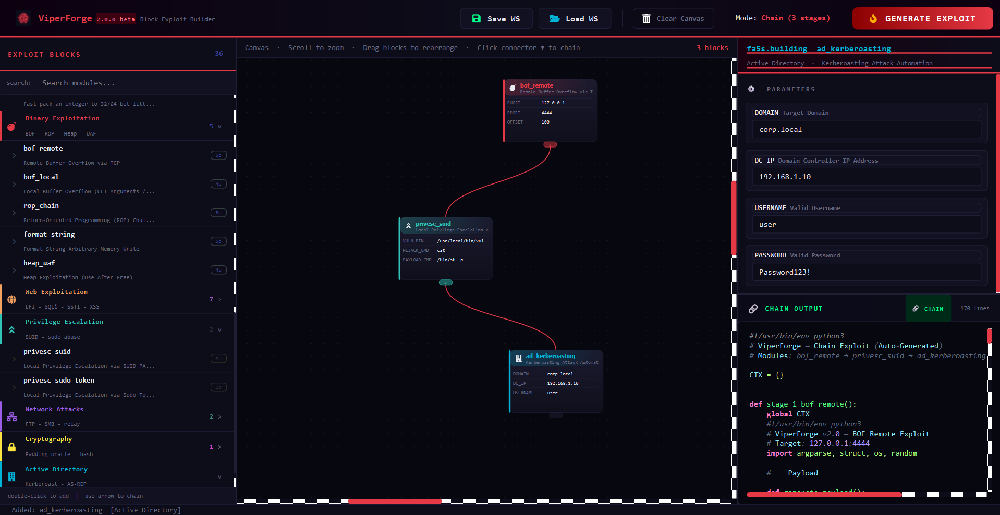

<div align="center">


# ViperForge
### Red Team Exploit Factory &nbsp;·&nbsp; `2.1.0-beta`
</div>

<div align="center">


**Visual, block-based Red Team exploit factory. Build multi-stage exploit chains by dragging blocks — no boilerplate, no guesswork.**

</div>

---

## ⚠️ Disclaimer

> **ViperForge is intended exclusively for authorized penetration testing, CTF competitions, and security research in controlled lab environments.**  
> Using this tool against systems you do not own or lack explicit written permission to test is **illegal**. The authors assume no liability for misuse.

---


## Interface



> *Three-pane layout: **Exploit Block Palette** (left) · **Canvas** (center) · **Parameters + Live Preview** (right).*  
> *Drag blocks onto the canvas, chain them with the ▼ connector, fill in parameters — hit **GENERATE EXPLOIT**.*

---

## Overview

ViperForge v2.1 is a node-based exploit builder. Each exploit module is a **block** you place on a canvas. Connect blocks with arrow connectors to define the attack flow — including **Success/Failure branch pins** for conditional logic — and optionally group blocks into reusable **macros**. ViperForge generates a single, clean Python exploit script from the entire chain — with deduped imports, a shared `CTX` context dictionary, and an optional XOR-encoded shellcode payload.

### Why ViperForge?

- **Visual chain building** — See your attack flow as a graph. No more copy-pasting boilerplate between scripts.
- **0-Day Builder micro-blocks** — Compose primitive operations (socket, send/recv, encode, XOR, HTTP, file I/O, conditionals, loops…) into custom exploit flows from scratch.
- **Dual-pin branching** — Give any block a Success/Failure pin pair and ViperForge generates the matching `try/except` or `if/else` logic automatically.
- **Macros** — Group any selection of blocks into a named, reusable macro block; drop it into other chains and it expands inline at generation time.
- **Evasion-first payloads** — C shellcode is compiled with GCC, XOR-encoded with a random key, and embedded as a self-decoding Python `ctypes`/`mmap` stub. No two outputs are identical.
- **Chain validator** — Detects broken chains (missing sockets, undefined variables, empty fields) before generation.
- **Dual interface** — Full GUI for visual building; Rich-powered CLI for headless/terminal-only workflows.

---

## Features

| Feature | Description |
|---|---|
| 🧩 **Visual Block Builder** | Drag-and-drop exploit blocks on an infinite canvas |
| 🔗 **Chain Mode** | Connect blocks to generate multi-stage exploit scripts |
| 🔀 **Dual-Pin Branching** | Success/Failure pins per block → generated `try/except` / `if/else` logic |
| 🧠 **Logic & Loop Blocks** | `if_else`, `loop`, `try_catch`, `variable_set` micro-blocks for real control flow |
| 📦 **Macro Blocks** | Group blocks into a named, reusable composite block; expands inline at generation |
| ⚡ **Live Code Preview** | Python syntax-highlighted output updates in real time |
| 🛡️ **Chain Validator** | Pre-generation static analysis — catches errors before generation |
| 💾 **Workspace Save / Load** | Save your block canvas to JSON and reload it later |
| 🔐 **Polymorphic XOR Encoder** | Random key · `ctypes`/`mmap` self-decoding shellcode stub |
| ⚙️ **C Payload Compiler** | Auto-compiles `.c` sources → raw shellcode via `gcc` + `objcopy` |
| 🌐 **40 Exploit Modules** | 18 classic exploits + 22 Builder micro-blocks |
| 🖥️ **CLI Mode** | Full `--cli` shell with Rich formatting and Chain Builder mode |

---

## Exploit Modules

### 🧱 Exploit Builder (0-Day) — Micro-Blocks

Compose custom exploit flows from primitive operations. Designed to be chained together into a flat sequential script with a shared `CTX` dictionary.

| Module | Description |
|---|---|
| `builder_socket` | Create a TCP network socket |
| `builder_send` | Send data via socket |
| `builder_recv` | Receive data from socket |
| `builder_recv_until` | Receive until a pattern is matched (with timeout) |
| `builder_pack` | Pack integers/bytes into a struct buffer |
| `builder_p32_p64` | Fast pack an integer to 32/64-bit little-endian |
| `builder_http_req` | HTTP GET / POST request |
| `builder_b64encode` | Base64 encode a variable |
| `builder_b64decode` | Base64 decode a variable |
| `builder_urlencode` | URL-encode a string |
| `builder_hex` | Hex encode or decode a variable |
| `builder_xor` | XOR a bytes variable with a key |
| `builder_shell_cmd` | Execute a local shell command (blocking / non-blocking) |
| `builder_read_file` | Read a local file into a variable |
| `builder_write_file` | Write a variable to a local file |
| `builder_print` | Print a message or variable to console |
| `builder_sleep` | Pause execution for N seconds |
| `builder_custom` | Inject arbitrary Python code |
| `builder_if_else` | Conditional branch based on a CTX variable |
| `builder_loop` | Iterate over a wordlist, numeric range, or file lines |
| `builder_try_catch` | Wrap the following blocks in `try/except` with fallback logic |
| `builder_variable_set` | Set a CTX variable — static value, regex extraction, or `eval` |

### 💥 Binary Exploitation

| Module | Description |
|---|---|
| `bof_remote` | Remote Buffer Overflow via TCP |
| `bof_local` | Local Buffer Overflow (CLI Arguments / Stdin) |
| `rop_chain` | Return-Oriented Programming (ROP) Chain Generator |
| `format_string` | Format String Arbitrary Memory Write |
| `heap_uaf` | Heap Exploitation — Use-After-Free |

### 🌐 Web Exploitation

| Module | Description |
|---|---|
| `web_lfi` | Local File Inclusion → RCE (Log Poisoning) |
| `web_sqli` | Blind SQLi → RCE via `INTO OUTFILE` |
| `web_ssti` | Server-Side Template Injection (Jinja2/Flask) |
| `web_cmd_exec` | OS Command Injection via HTTP (Base64-encoded, WAF-evasive) |
| `web_xxe` | XML External Entity (XXE) Data Exfiltration |
| `web_deserialization` | Insecure Deserialization (Python Pickle) |
| `web_ssrf` | SSRF Internal Port Scanner |

### 🔼 Privilege Escalation

| Module | Description |
|---|---|
| `privesc_suid` | SUID PATH Hijacking |
| `privesc_sudo_token` | Sudo Token Hijacking via `/proc/[pid]/mem` |

### 🌍 Network Attacks

| Module | Description |
|---|---|
| `network_ftp_anon` | FTP Anonymous Login & Payload Upload |
| `network_smb_relay` | SMB Relay Attack (Wrapper) |

### 🔒 Cryptography

| Module | Description |
|---|---|
| `crypto_padding_oracle` | Padding Oracle Attack Automation |

### 🏢 Active Directory

| Module | Description |
|---|---|
| `ad_kerberoasting` | Kerberoasting Attack Automation (Impacket) |

---

## Installation

### Requirements

- **Python 3.10+**
- **GCC + binutils** (for C payload compilation)
  ```bash
  sudo apt install gcc binutils gcc-multilib
  ```
- **Python dependencies:**
  ```bash
  pip install -r requirements.txt
  ```

`requirements.txt`:
```
PyQt6>=6.6.0
jinja2>=3.1.0
rich>=13.0.0
qtawesome>=1.3.0
```

### Setup

```bash
# Clone the repository
git clone https://github.com/MrEx-Right/ViperForge.git
cd ViperForge

# Install Python dependencies
pip install -r requirements.txt

# Launch the GUI (default)
python viperforge.py

# Or launch the CLI
python viperforge.py --cli
```

### Windows Standalone `.exe` (optional)

A `.spec` file is included to build a windowed, single-file Windows executable with PyInstaller:

```bash
pip install pyinstaller
pyinstaller ViperForge.spec
# → dist/ViperForge.exe
```

This launches straight into the GUI with no console window. `--cli` mode isn't included in this build (it needs an attached terminal) — run it from source instead.

> ⚠️ **Windows Defender / antivirus will very likely flag this `.exe`.** This is a known false positive, not a sign of tampering — see [Antivirus Warnings](#antivirus--windows-defender-warnings) below before reporting it as broken.

---

## Antivirus / Windows Defender Warnings

**This is expected, and it does not mean the code has been tampered with.**

If you build or download a standalone `.exe` of ViperForge, Windows Defender (or another AV) will very likely flag it. Two independent, well-understood reasons:

1. **The tool itself is a shellcode encoder.** ViperForge compiles raw C shellcode and embeds it as an XOR-encoded, self-decoding `ctypes`/`mmap` payload stub — exactly the code shape AV heuristics are built to catch. Tools in this category (Metasploit, `msfvenom`, mimikatz, Impacket) get flagged for the same reason, signed or not.
2. **The `.exe` is built with PyInstaller and is unsigned.** Packed, unsigned Python binaries are a common malware-delivery shape, so SmartScreen/Defender apply extra scrutiny regardless of what's actually inside — this project does not currently ship a paid code-signing certificate.

**What to do about it:**

- **Prefer running from source** — `pip install -r requirements.txt && python viperforge.py`. Defender scans a running/packed binary far more aggressively than a plain `.py` file, and you can read every line before executing it.
- If you do use a prebuilt `.exe`, add a Defender exclusion for that file (or its folder) rather than disabling AV protection system-wide.
- Don't trust a binary you can't verify — build it yourself with `pyinstaller ViperForge.spec` (see above) so what you run matches exactly what's in this repo.
- As always: only run this tool against systems you're explicitly authorized to test — see the Disclaimer at the top of this document.

---

## Usage

### GUI Mode (default)

```bash
python viperforge.py
```

1. **Double-click** a block in the left palette to add it to the canvas.
2. Click the **▼ connector** at the bottom of a block and then click another block to chain them.
3. Select a block and fill in its **parameters** in the right panel.
4. Watch the **live code preview** update as you type.
5. Click **GENERATE EXPLOIT** — choose a save path and the script is written instantly.

**Toolbar actions:**

| Button | Action |
|---|---|
| 💾 Save WS | Save current canvas state to a JSON workspace file |
| 📂 Load WS | Restore a previously saved canvas |
| 🗑️ Clear Canvas | Remove all blocks and connectors |
| 🔥 GENERATE EXPLOIT | Validate chain and generate the Python exploit script |

**Canvas shortcuts:**

| Input | Action |
|---|---|
| Scroll wheel | Zoom in / out |
| Middle mouse drag | Pan canvas |
| Left mouse drag on empty canvas | Rubber-band select multiple blocks |
| `Delete` / `Backspace` | Delete selected blocks or connectors |
| Right-click a block | Edit · Replace with another module · Add/Remove Failure Pin · Delete |
| Right-click with 2+ blocks selected | Create Macro from the selected blocks |

### CLI Mode

```bash
python viperforge.py --cli
```

Select **Single Exploit Mode** to run the parameter wizard for a single module, or **Chain Builder Mode** to compose a multi-block chain interactively and generate the script in one step.

---

## Chain Validation

Before generating, ViperForge runs a static analysis pass on the block chain:

| Check | Severity |
|---|---|
| `builder_send/recv/recv_until` used without a preceding `builder_socket` | ❌ Error |
| A block reads a variable not produced by any earlier block | ⚠️ Warning |
| `builder_custom` has an empty `CODE` field | ❌ Error |
| `builder_pack` / `builder_p32_p64` VALUE is not a valid integer/hex | ❌ Error |
| `builder_sleep` SECONDS is not a valid number | ❌ Error |
| `builder_http_req` URL does not start with `http://` or `https://` | ⚠️ Warning |
| `builder_read_file` / `builder_write_file` FILE_PATH is empty | ❌ Error |
| Builder blocks and classic exploit blocks mixed in the same chain | ⚠️ Warning |

Errors block generation. Warnings are shown but do not prevent script output.

---

## Branching & Macros

### Dual-Pin Branching

Right-click any block and choose **Add Failure Pin (Branch)** to split its bottom connector into two pins:

- **Success (green, `OK`)** — the normal chain path.
- **Failure (red, `ERR`)** — taken if the block raises/fails.

Connect each pin to a different downstream block to define what happens on success vs. failure. At generation time ViperForge turns the branch into real Python control flow (`try/except` for builder chains, `if/else` for classic chains) — no manual wiring required.

### Macros

Select two or more blocks on the canvas (rubber-band drag, or `Ctrl`/`Shift`-click), right-click, and choose **Create Macro**. Give it a name and description — the selected blocks *and* the connections between them are saved as a single reusable unit under `workspaces/macros/`.

Saved macros show up as a **Macros** category in the block palette and in the toolbar's **Macros** dropdown. Dropping a macro onto the canvas adds one gold-accented composite block; at generation time it's expanded inline into its constituent blocks, in their original order and wiring.

---

## Generated Output

Scripts are saved to the `output/` directory. Chain scripts include:

- `#!/usr/bin/env python3` shebang
- Auto-generated header with the block/module list
- **Builder chains** — flat sequential code with deduped imports and a shared `CTX = {}` dict
- **Classic chains** — each module wrapped in `stage_N_name()` functions, called by `main()`
- **Hybrid chains** — builder blocks as flat code, classic modules as staged functions

---

## C Payloads

Pre-built C payload sources in `templates/payloads/`:

| File | Description |
|---|---|
| `execve.c` | Linux `execve("/bin/sh")` — 32-bit x86 position-independent |
| `win_exec.c` | Windows shellcode via PEB parsing + API hashing (no import table) |

Payloads are compiled with GCC (`-m32 -fno-stack-protector -z execstack -nostdlib -static`), raw `.text` bytes extracted with `objcopy`, XOR-encoded with a random key, and embedded as a `ctypes`/`mmap` self-decoding Python stub.

---

## Adding New Modules

**1. Create a Jinja2 template** in `templates/exploits/my_exploit.j2`:

```python
#!/usr/bin/env python3
# ViperForge — my_exploit
import socket

r = socket.create_connection(("{{ RHOST }}", {{ RPORT }}))
# ... your exploit logic
```

**2. Register the module** in `viperforge/registry.py`:

```python
ExploitDef(
    id=41, name="my_exploit", category="Binary Exploitation",
    description="My Custom Exploit",
    template="my_exploit",
    options=[
        ExploitOption("RHOST", "Target IP Address", "127.0.0.1"),
        ExploitOption("RPORT", "Target Port", "4444"),
    ],
),
```

ViperForge automatically discovers the new module — it appears in both the GUI palette and the CLI menus immediately.

---

## Architecture

```
viperforge.py  ──────────────────────────────────────────────────
       │                                                          │
       ▼ (--cli)                                    ▼ (default)  │
 viperforge/cli/shell.py                  viperforge/gui/         │
  Rich-powered interactive shell          ┌─────────────────────┐│
  ├─ Single Exploit Mode                  │ main_window.py      ││
  └─ Chain Builder Mode                  │ block_palette.py    ││
                                         │ canvas.py           ││
                                         │ block_item.py       ││
                                         │ macro_block_item.py ││
                                         │ macro_dialog.py     ││
                                         │ connector.py        ││
                                         │ param_panel.py      ││
                                         │ preview_panel.py    ││
                                         └─────────────────────┘│
                                                  │               │
                        ──────────────────────────┘               │
                        ▼                                          │
              viperforge/engine.py   (Jinja2 rendering + chain assembly,
                                       Success/Failure branching, macro expansion)
                        │
           ┌────────────┴────────────┐
           ▼                         ▼
  viperforge/compiler.py    viperforge/encoder.py
  (C source → shellcode)    (XOR encode + ctypes/mmap stub)
           │
           ▼
  viperforge/validator.py   (pre-generation chain analysis)
  viperforge/registry.py    (40 ExploitDef entries)
  viperforge/session.py     (per-block option storage)
  viperforge/macro.py       (macro definitions, save/load, expansion)
```

---

## Dependencies

| Package | Version | Purpose |
|---|---|---|
| `PyQt6` | ≥ 6.6.0 | GUI framework (PyQt5 also supported) |
| `jinja2` | ≥ 3.1.0 | Exploit template rendering |
| `rich` | ≥ 13.0.0 | CLI formatting and interactive prompts |
| `qtawesome` | ≥ 1.3.0 | FontAwesome icons in the GUI |

---

## License

This project is licensed under the **GNU General Public License v3.0 (GPLv3)**.

You are free to use, study, modify, and distribute this software under the terms of the GPLv3. Any derivative works must also be distributed under the same license.

See [LICENSE](LICENSE) for the full license text, or visit [gnu.org/licenses/gpl-3.0](https://www.gnu.org/licenses/gpl-3.0.html).

---

<div align="center">
Made for the red team. Use responsibly.
</div>
