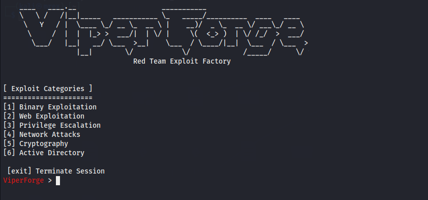

```
    ____   ____.__                     ___________                           
    \   \ /   /|__|_____   ___________ \_   _____/__________  ____   ____  
     \   Y   / |  \____ \_/ __ \_  __ \ |    __)/  _ \_  __ \/ ___\_/ __ \ 
      \     /  |  |  |_> >  ___/|  | \/ |     \(  <_> )  | \/ /_/  >  ___/ 
       \___/   |__|   __/ \___  >__|    \___  / \____/|__|  \___  / \___  >
                  |__|        \/            \/             /_____/      \/ v1.1.0-beta
                                Red Team Exploit Factory
```

<div align="center">


**Wizard-driven, modular Red Team exploit factory built in Go.**  
*Inspired by Metasploit's interactive console — built for pwn scripts and payload generation.*

</div>

---

## ⚠️ Disclaimer

> **ViperForge is intended exclusively for authorized penetration testing, CTF competitions, and security research in controlled lab environments.**  
> Using this tool against systems you do not own or lack explicit written permission to test is **illegal**. The authors assume no liability for misuse.

---

## Overview

ViperForge is an interactive, wizard-driven CLI framework that automates the generation of production-ready exploit scripts. It features a Metasploit-style interactive console, a categorized exploit registry with 18 modules, a polymorphic XOR encoder for shellcode obfuscation, automated C payload compilation, and a Python template engine (pwntools/requests compatible).

### Why ViperForge?

- **Speed**: Eliminate repetitive boilerplate. Go from vulnerability → weaponized script in seconds.
- **Evasion-first**: Every binary payload is XOR-encoded with a polymorphic JMP-CALL-POP decoder stub — no two outputs are identical.
- **Extensible**: Add new exploit categories and templates with minimal effort.
- **CTF-ready**: Scripts are generated with pwntools/requests patterns that work out-of-the-box on competition platforms.

---

## Features

| Feature | Description |
|---|---|
| 🗂️ **Categorized Exploit Registry** | 18 modules across 6 attack categories |
| 🧙 **Interactive Wizard** | Metasploit-style parameter configuration per exploit |
| 🔐 **Polymorphic XOR Encoder** | Runtime-randomized key + JMP-CALL-POP decoder stub |
| ⚙️ **C Payload Compiler** | Auto-compiles `.c` payloads → shellcode via `gcc` + `objcopy` |
| 📄 **Template Engine** | Go-templated Python exploit script generation |
| 📜 **Command History** | Persistent readline history across sessions |
| 🧹 **Clear / Back navigation** | MSF-style shell UX with `clear`, `back`, `exit` |

---

## Exploit Categories & Modules

### 💥 Binary Exploitation
| # | Module | Description |
|---|---|---|
| 1 | `bof_remote` | Remote Buffer Overflow via TCP |
| 2 | `bof_local` | Local Buffer Overflow (CLI Arguments / Stdin) |
| 3 | `rop_chain` | Return-Oriented Programming (ROP) Chain Generator |
| 4 | `format_string` | Format String Arbitrary Memory Write |
| 5 | `heap_uaf` | Heap Exploitation — Use-After-Free |

### 🌐 Web Exploitation
| # | Module | Description |
|---|---|---|
| 6 | `web_lfi` | Local File Inclusion → RCE (Log Poisoning) |
| 7 | `web_sqli` | Blind SQLi → RCE via `INTO OUTFILE` |
| 8 | `web_ssti` | Server-Side Template Injection (Jinja2/Flask) |
| 9 | `web_cmd_exec` | OS Command Injection via HTTP Parameters |
| 10 | `web_xxe` | XML External Entity (XXE) Data Exfiltration |
| 11 | `web_deserialization` | Insecure Deserialization (Python Pickle) |
| 12 | `web_ssrf` | SSRF Internal Port Scanner |

### 🔼 Privilege Escalation
| # | Module | Description |
|---|---|---|
| 13 | `privesc_suid` | SUID PATH Hijacking |
| 14 | `privesc_sudo_token` | Sudo Token Hijacking |

### 🌍 Network Attacks
| # | Module | Description |
|---|---|---|
| 15 | `network_ftp_anon` | FTP Anonymous Login & Payload Upload |
| 16 | `network_smb_relay` | SMB Relay Attack (Wrapper) |

### 🔒 Cryptography
| # | Module | Description |
|---|---|---|
| 17 | `crypto_padding_oracle` | Padding Oracle Attack Automation |

### 🏢 Active Directory
| # | Module | Description |
|---|---|---|
| 18 | `ad_kerberoasting` | Kerberoasting Attack Automation |

---

## Installation

### Prerequisites

- **Go** 1.21+
- **GCC** (for C payload compilation — `gcc`, `objcopy`)
  ```bash
  sudo apt install gcc binutils
  ```
- **Python 3** + `pwntools` / `requests` (for running generated exploit scripts)

### Setup

```bash
# Clone the repository
git clone https://github.com/MrEx-Right/ViperForge.git
cd viperforge

# Download Go dependencies
go mod tidy

# Make the launcher executable
chmod +x viperforge.sh

# Run
./viperforge.sh
```

> The launcher script automatically compiles the Go binary on first run (and re-compiles whenever source changes), so you never need to run `go build` manually.

---

## Usage

```bash
./viperforge.sh
```

### Navigation

```
ViperForge > [1-6]          Select an exploit category
ViperForge (Category) > [N] Select a specific exploit module
ViperForge > clear          Clear screen
ViperForge > exit           Terminate session
```

### CLI Preview



### Workflow Example — Remote Buffer Overflow

```
[1] Binary Exploitation
     ↓
[1] bof_remote
     ↓
 > RHOST (Target IP Address) [127.0.0.1]: 10.10.14.5
 > RPORT (Target Port) [4444]: 9001
 > OFFSET (Offset to EIP/RIP) [100]: 112
 > EIP (Return Address) [0x080484b6]: 0xdeadbeef
 > PAYLOAD (C Payload Name) []: execve
     ↓
[ EXPLOIT PREVIEW & EXECUTION PLAN ]
     ↓
[1] Generate Exploit Script  →  output/bof_remote_exploit.py
```

### C Payloads

Pre-built C payload sources in `templates/payloads/`:

| File | Description |
|---|---|
| `execve.c` | Linux `execve("/bin/sh")` shellcode |
| `win_exec.c` | Windows shellcode via PEB parsing + API hashing |

Payloads are auto-compiled with GCC, extracted via `objcopy`, XOR-encoded with a random key, and embedded into the generated Python script.

---

## Adding New Exploits

**1. Create a template** in `templates/exploits/my_exploit.tmpl`:
```python
#!/usr/bin/env python3
# ViperForge Generated Exploit — my_exploit
from pwn import *

r = remote("{{.RHOST}}", {{.RPORT}})
# ... your exploit logic
```

**2. Register the module** in `core/registry.go`:
```go
{
    ID:          19,
    Name:        "my_exploit",
    Category:    "Binary Exploitation",
    Description: "My Custom Exploit",
    Template:    "my_exploit",
    Options: []ExploitOption{
        {"RHOST", "Target IP Address", "127.0.0.1"},
        {"RPORT", "Target Port", "4444"},
    },
},
```

That's it — ViperForge automatically discovers and routes the new module.

---

## Architecture

```
User Input (readline)
       │
       ▼
  console/shell.go  ──► Category Menu ──► Exploit Menu ──► Wizard
                                                               │
                              ┌────────────────────────────────┘
                              ▼
                        core/session.go    (stores user options)
                              │
                    ┌─────────┴──────────┐
                    ▼                    ▼
             core/compiler.go      core/templater.go
         (C source → shellcode)   (template → .py script)
                    │
                    ▼
             core/encoder.go
         (XOR encode + stub injection)
```

---

## Dependencies

| Package | Purpose |
|---|---|
| [`github.com/chzyer/readline`](https://github.com/chzyer/readline) | Interactive CLI with history & autocomplete |
| `crypto/rand` (stdlib) | Cryptographically secure random key generation |

---

## License

This project is licensed under the **GNU General Public License v3.0 (GPLv3)**.

You are free to use, study, modify, and distribute this software under the terms of the GPLv3. Any derivative works must also be distributed under the same license.

See [LICENSE](LICENSE) for the full license text, or visit [gnu.org/licenses/gpl-3.0](https://www.gnu.org/licenses/gpl-3.0.html).

---

<div align="center">
Made for the red team. Use responsibly.
</div>
